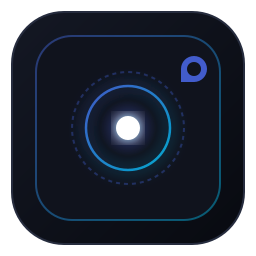

# TouchMyMac

  
  <h3>Turn your phone or iPad into a touchpad for your Mac. For a true theater mode experience.</h3>
  
Control movies, browse websites, and manage Terminal from the comfort of your couch or bed.

  

    
  

  
<b>Pre-built standalone application • No terminal setup or git cloning required</b>

---

## ✨ Why TouchMyMac?

- 🎬 **True Theater Mode**: Relax on your sofa and navigate movies, YouTube, Netflix, and music with single-hand comfort.
- 🖲️ **Dedicated Thumb Scroll Wheel**: Slide your thumb along the right edge of the trackpad with crisp mechanical haptic clicks without needing two fingers.
- ⚡ **Liquid Smooth Gliding Cursor**: Hardware-level sub-pixel micro-interpolation and live sensitivity control (`0.8x` to `4.0x`) for zero-lag cursor response.
- ⌨️ **Floating Terminal Toolbar**: Virtual keyboard accessory bar pins directly above your software keyboard with `Esc`, `Tab`, `Ctrl`, `Opt`, `Cmd`, and arrows for seamless shell navigation and shortcuts like `Ctrl+C`.
- 📺 **YouTube Deck with PiP & Speed**: Instant 1-tap buttons for Picture-in-Picture (`I`), Speed Down (`<`), Speed Up (`>`), Captions (`C`), 10s seek jumps (`J`/`L`), and Fullscreen (`F`).
- 📱 **Zero Mobile Installs**: Works instantly on any modern phone (Android Chrome, iPhone/iPad Safari) over your local Wi-Fi. Just scan the menu bar QR code.
- 🎧 **Private Headphone Audio Streaming**: Stream sound straight to your phone headphones with a 1-tap Mac speaker mute for midnight movie sessions without disturbing the room.
  > **Note**: *Wireless audio routing via ScreenCaptureKit is currently in an active experimental stage. Buffer latency and compression are being actively enhanced in upcoming releases.*

---

## 🚀 30-Second Quick Start

1. **Download the App**: Grab the latest ready-to-run [TouchMyMac.app](https://github.com/SamSeenX/TouchMyMac/releases/latest) from the Releases page.
2. **Launch & Scan**: Open `TouchMyMac.app` from your menu bar and scan the popover QR code with your phone or iPad camera.
3. **Kick Back & Control**: Enjoy fluid, wireless touchpad control directly from your bed or couch.

---

## 🔒 Privacy & Offline First

TouchMyMac operates entirely on your local Wi-Fi network. No telemetry, no third-party cloud servers, and no accounts.

---

  Released under the <a href="LICENSE">MIT License</a> • Created with ❤️ for home theater lovers

